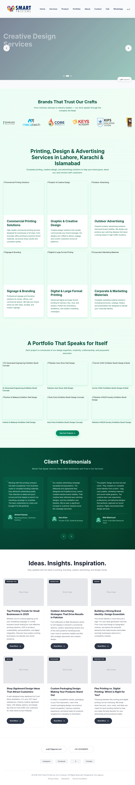
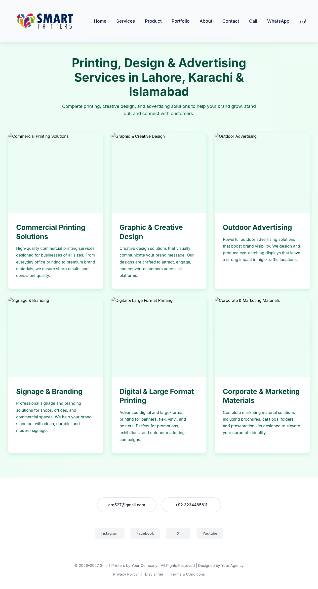
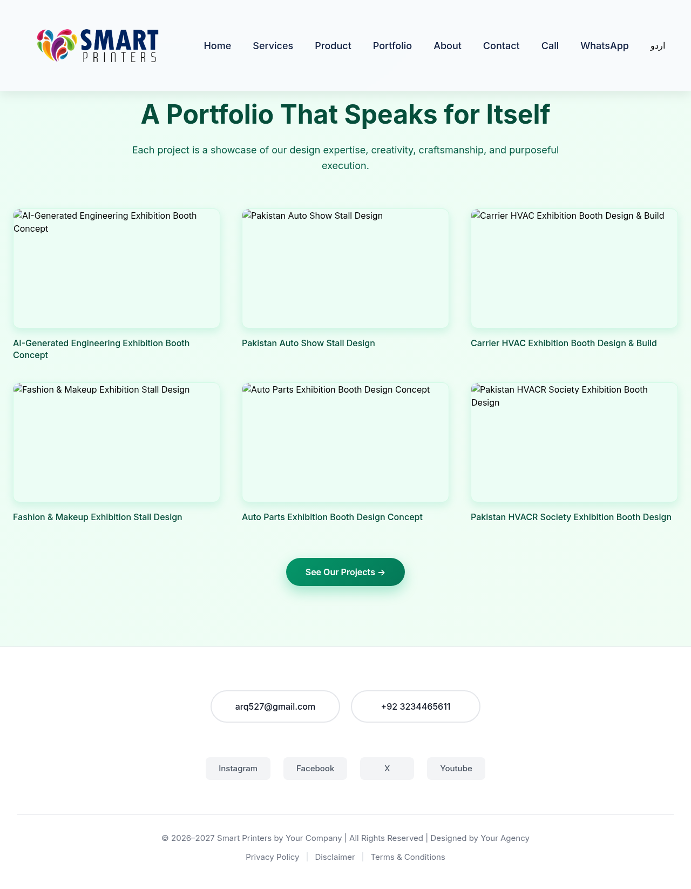
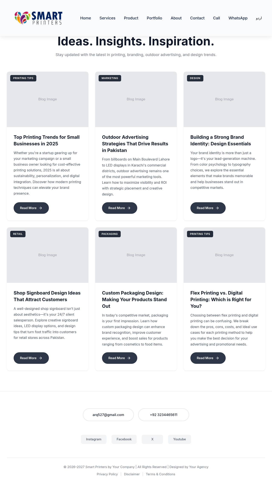

# Smart Printers – Business Website

> **Client project (frontend):** marketing website for **Smart Printers**, a printing & advertising business.

A modern, animated frontend marketing website for **Smart Printers**, a printing, design and advertising business in Pakistan. The site showcases the company's printing and signage services, portfolio of exhibition-stand work, client testimonials and blog insights, and makes it easy for visitors to call or message the business on WhatsApp.

## Screenshots

| Home | Services |
| --- | --- |
|  |  |
| **Portfolio** | **Blogs** |
|  |  |

## Features

- **Hero slider** – auto-rotating banners for printing, creative design and outdoor advertising, with a "Brands that trust us" client-logo strip.
- **Bilingual content** – English / Urdu toggle for the main hero content.
- **Services** – cards for commercial printing, graphic & creative design, outdoor advertising, signage & branding, large-format printing and marketing materials.
- **Portfolio** – exhibition booth and stall design projects.
- **Testimonials** – client reviews section.
- **Blog / insights** – articles on printing trends, outdoor advertising, branding and packaging.
- **Quick contact** – click-to-call, WhatsApp chat link with a prefilled message, and email/contact details in the footer.
- **Responsive navigation** – desktop dropdown menus (Services, Products) and a mobile menu.
- **Smooth animations** – scroll and hover animations with Framer Motion.
- **Client-side routing** – Home, Services, Portfolio, Testimonials and Blogs pages via React Router.

## Tech stack

- [React 19](https://react.dev/) + [Vite](https://vite.dev/)
- [React Router](https://reactrouter.com/)
- [Framer Motion](https://www.framer.com/motion/)
- SCSS Modules (component-scoped styles) + Tailwind CSS base layer

## Getting started

```bash
npm install
npm run dev        # start the dev server at http://localhost:5173
npm run build      # production build in dist/
npm run preview    # preview the production build
```

Business contact details (phone, WhatsApp, email, address) are configured in `src/Config/contact.js`.

## Project structure

```
smart-printers-website/
├── public/
│   └── images/              # logo, hero banners, client logos
├── src/
│   ├── Animations/          # shared Framer Motion variants
│   ├── Components/          # Navbar, Hero, ServicePreview, CTA, ContactForm, Footer
│   ├── Config/              # contact details
│   ├── Content/             # English / Urdu copy
│   ├── Pages/               # Home, Services, Portfolio, Testimonials, Blogs, About, Contact
│   ├── App.jsx              # routes
│   ├── main.jsx             # entry point
│   └── index.css
├── index.html
├── vite.config.js
└── package.json
```
